# Diagramas del Entregable 2 - O'Clock Lens

Cada diagrama tiene su fuente Mermaid editable en `fuentes/` y su imagen en `imagenes/`.

**Enlace editable:** abrir https://mermaid.live, pegar el contenido del archivo `.mmd` y copiar el enlace de "Share" (Copy link). Pegar ese enlace en la columna "Enlace editable" de cada diagrama antes de generar el PDF.

## C4 Nivel 1 - Contexto

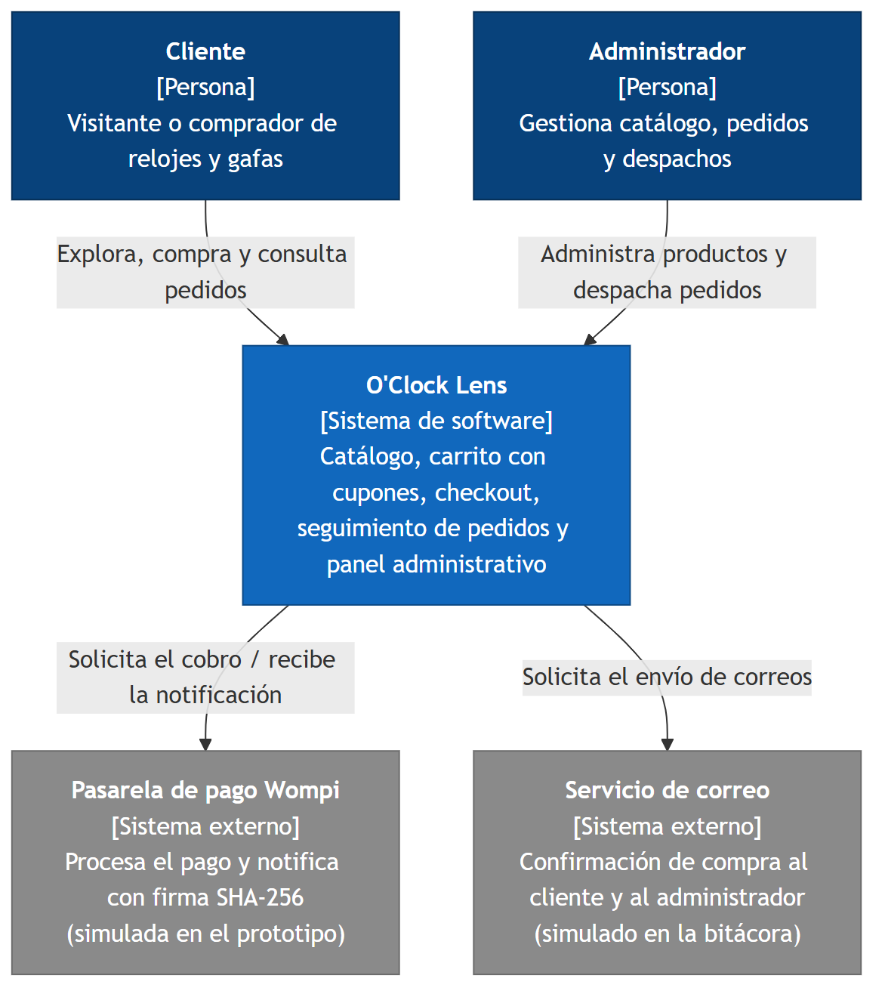

Muestra a O'Clock Lens como una caja negra con sus dos actores (Cliente y Administrador, del Entregable 1) y los dos sistemas externos de los que depende: la pasarela Wompi (RF-10 a RF-12) y el servicio de correo (RF-13). En el prototipo ambos están simulados.

- Fuente editable: [fuentes/c4-nivel1-contexto.mmd](fuentes/c4-nivel1-contexto.mmd)
- Enlace editable (mermaid.live): _pendiente de pegar_

## C4 Nivel 2 - Contenedores

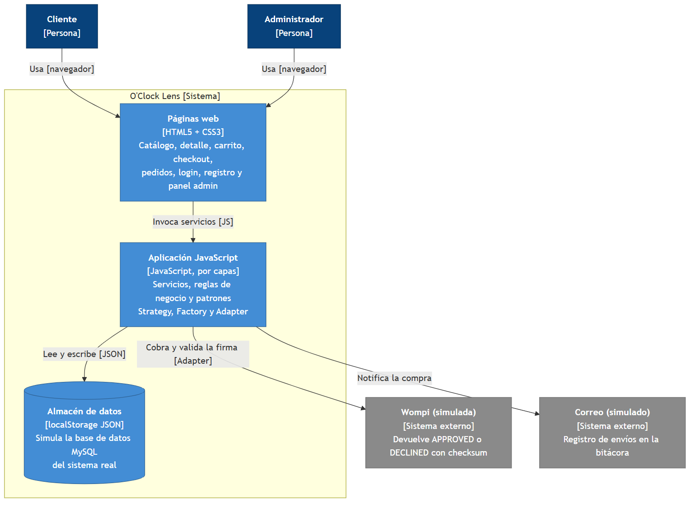

Descompone el sistema en las páginas web (HTML/CSS), la aplicación JavaScript por capas y el almacén localStorage. El almacén sustituye a la base de datos MySQL del sistema real y la aplicación habla con Wompi y el correo mediante un adaptador y un notificador.

- Fuente editable: [fuentes/c4-nivel2-contenedores.mmd](fuentes/c4-nivel2-contenedores.mmd)
- Enlace editable (mermaid.live): _pendiente de pegar_

## C4 Nivel 3 - Componentes

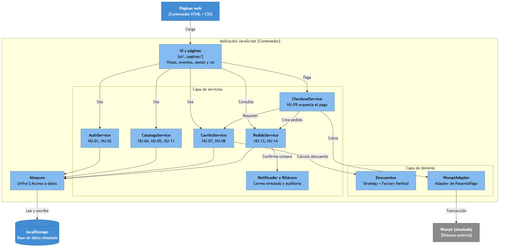

Detalla la aplicación JavaScript: servicios por caso de uso (Auth, Catálogo, Carrito, Pedido, Checkout), el dominio con los patrones (Descuentos = Strategy + Factory, WompiAdapter = Adapter) y el acceso a datos. Cada servicio indica las HU del MVP que soporta.

- Fuente editable: [fuentes/c4-nivel3-componentes.mmd](fuentes/c4-nivel3-componentes.mmd)
- Enlace editable (mermaid.live): _pendiente de pegar_

## C4 Nivel 4 - Código: Strategy + Factory

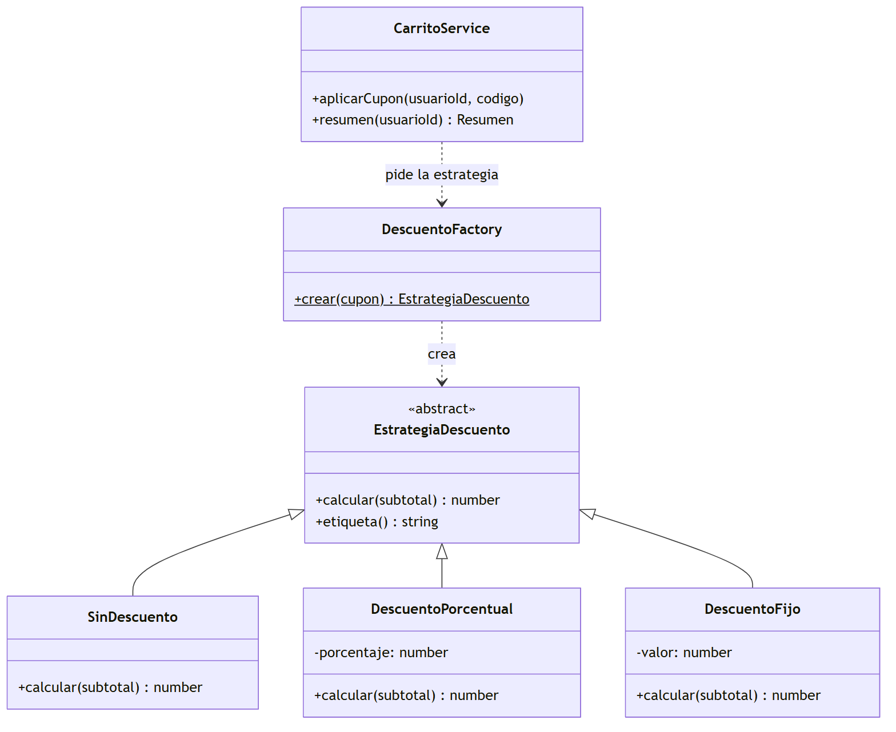

Clases del cálculo de descuentos. DescuentoFactory decide según el cupón (RN-03: valor con "%" es porcentual, numérico es fijo) y devuelve una EstrategiaDescuento intercambiable que usa CarritoService.

- Fuente editable: [fuentes/c4-nivel4-descuentos.mmd](fuentes/c4-nivel4-descuentos.mmd)
- Enlace editable (mermaid.live): _pendiente de pegar_

## C4 Nivel 4 - Código: Adapter y checkout

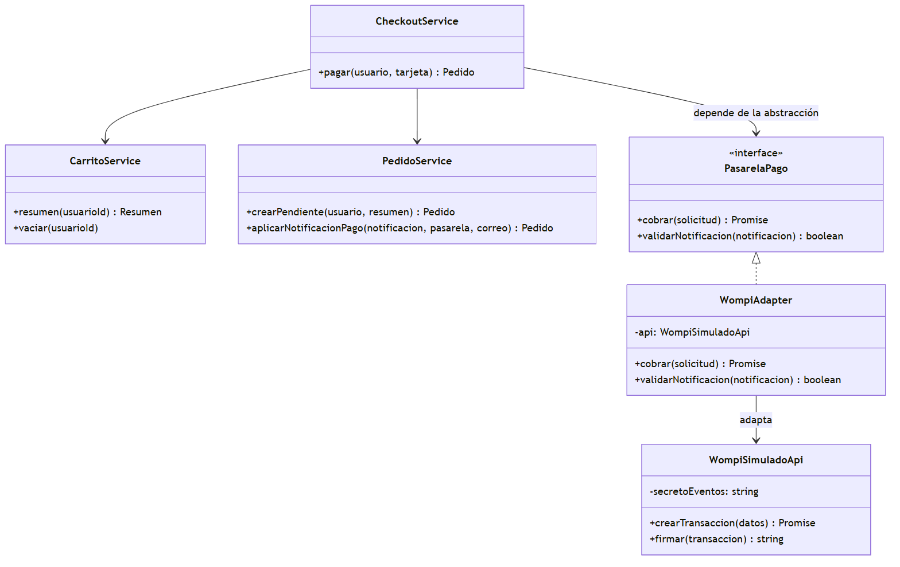

CheckoutService depende de la abstracción PasarelaPago; WompiAdapter la implementa traduciendo pesos a centavos y APPROVED/DECLINED a booleano, y valida el checksum de la notificación (RNF-02).

- Fuente editable: [fuentes/c4-nivel4-pasarela.mmd](fuentes/c4-nivel4-pasarela.mmd)
- Enlace editable (mermaid.live): _pendiente de pegar_

## C4 Nivel 4 - Código: modelo de dominio

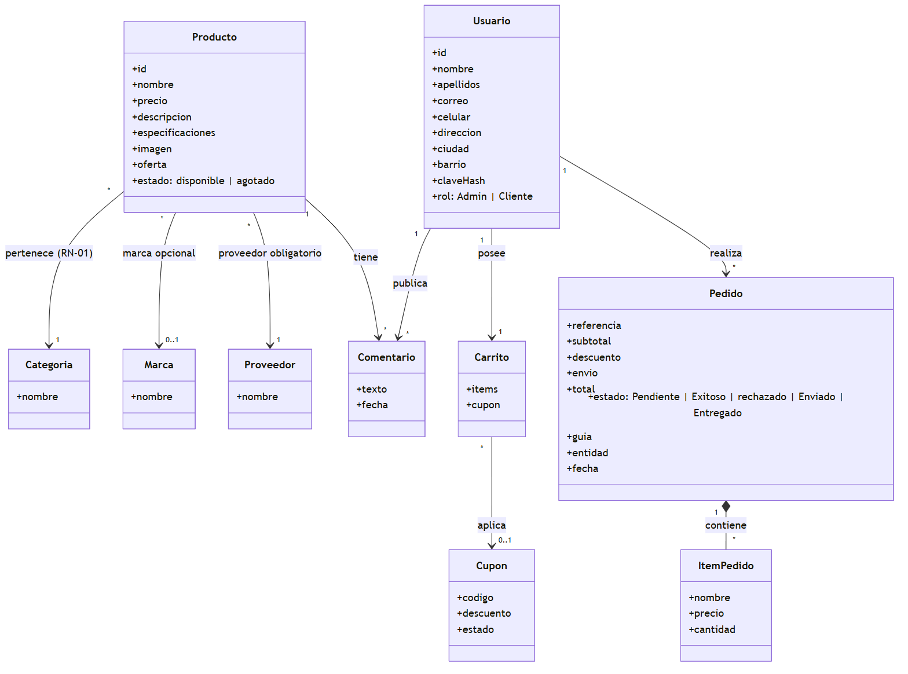

Diagrama de clases del Entregable 1 refinado para el prototipo: se conservan Usuario, Producto, Categoría, Marca, Proveedor, Comentario, Cupón y Pedido, y se añaden Carrito e ItemPedido. Respeta RN-01 (categoría y proveedor obligatorios, marca opcional).

- Fuente editable: [fuentes/c4-nivel4-dominio.mmd](fuentes/c4-nivel4-dominio.mmd)
- Enlace editable (mermaid.live): _pendiente de pegar_

## Actividades HU-01 Registro de cuenta

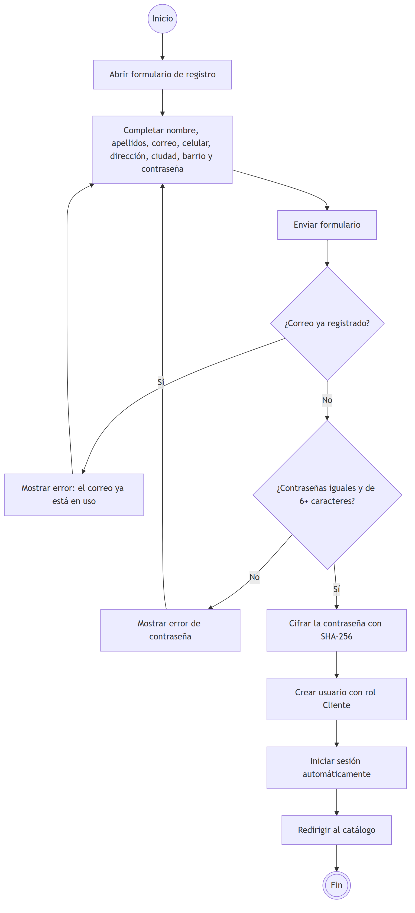

Flujo principal del registro con las decisiones de correo duplicado y contraseña; al final crea el usuario con rol Cliente, cifra la clave e inicia sesión.

- Fuente editable: [fuentes/act-hu01-registro.mmd](fuentes/act-hu01-registro.mmd)
- Enlace editable (mermaid.live): _pendiente de pegar_

## Actividades HU-02 Inicio de sesión

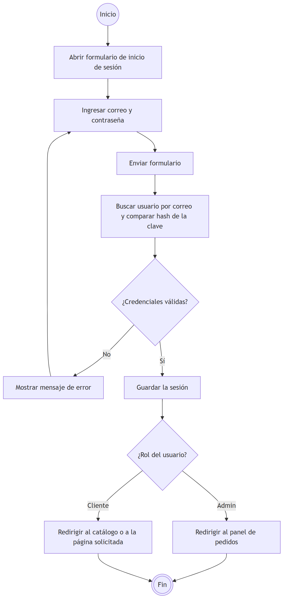

Valida el hash de la clave y redirige según el rol: Admin al panel de pedidos, Cliente al catálogo o a la página que pidió.

- Fuente editable: [fuentes/act-hu02-login.mmd](fuentes/act-hu02-login.mmd)
- Enlace editable (mermaid.live): _pendiente de pegar_

## Actividades HU-04 y HU-05 Catálogo y detalle

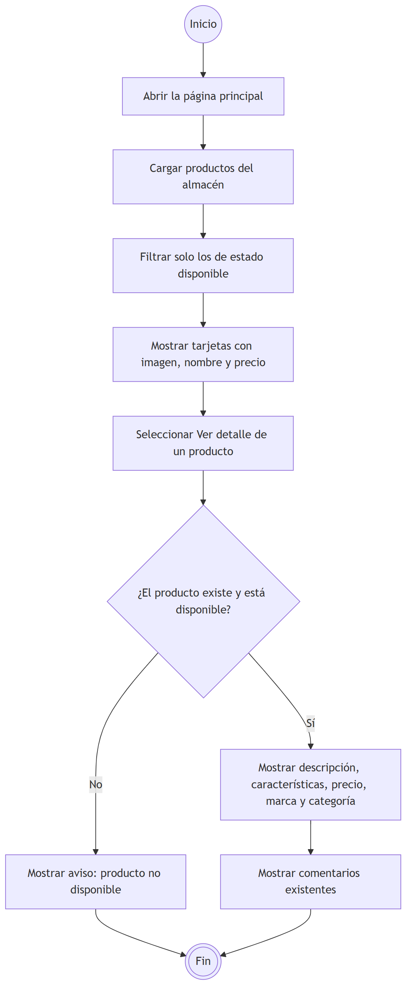

Carga solo productos disponibles (RF-04), muestra imagen, nombre y precio y, al seleccionar uno, su detalle con características y comentarios.

- Fuente editable: [fuentes/act-hu04-hu05-catalogo.mmd](fuentes/act-hu04-hu05-catalogo.mmd)
- Enlace editable (mermaid.live): _pendiente de pegar_

## Actividades HU-07 Agregar al carrito

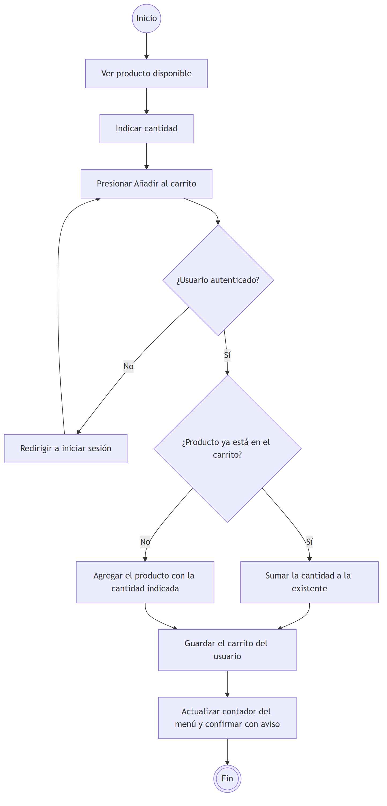

Exige sesión y, si el producto ya está en el carrito, suma la cantidad en lugar de duplicar la línea (RF-07).

- Fuente editable: [fuentes/act-hu07-carrito.mmd](fuentes/act-hu07-carrito.mmd)
- Enlace editable (mermaid.live): _pendiente de pegar_

## Actividades HU-09 Realizar pedido con Wompi

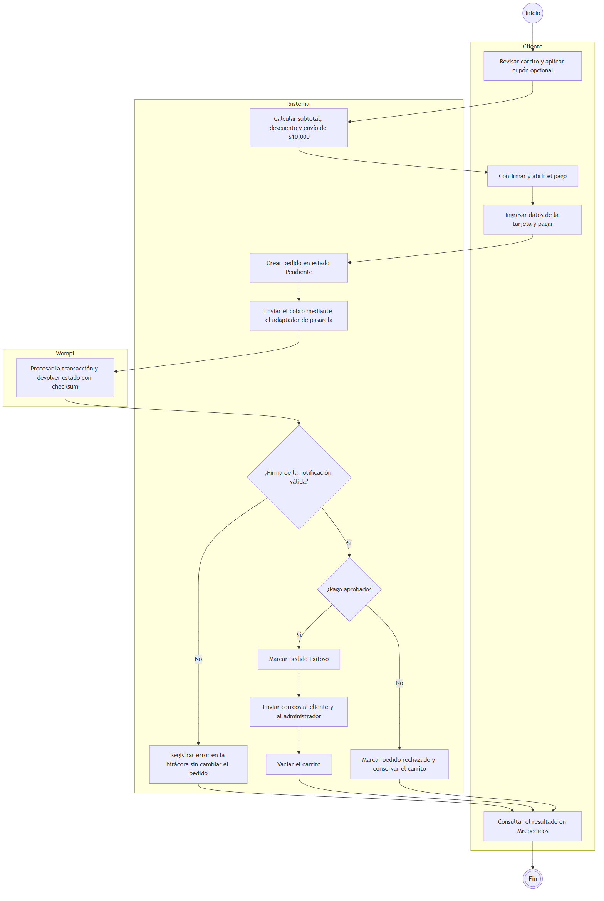

Tres carriles (Cliente, Sistema, Wompi). El pedido nace Pendiente (RN-04); solo una notificación con firma válida lo pasa a Exitoso o rechazado; si es exitoso se envían correos y se vacía el carrito.

- Fuente editable: [fuentes/act-hu09-checkout.mmd](fuentes/act-hu09-checkout.mmd)
- Enlace editable (mermaid.live): _pendiente de pegar_

## Actividades HU-11 Gestionar productos

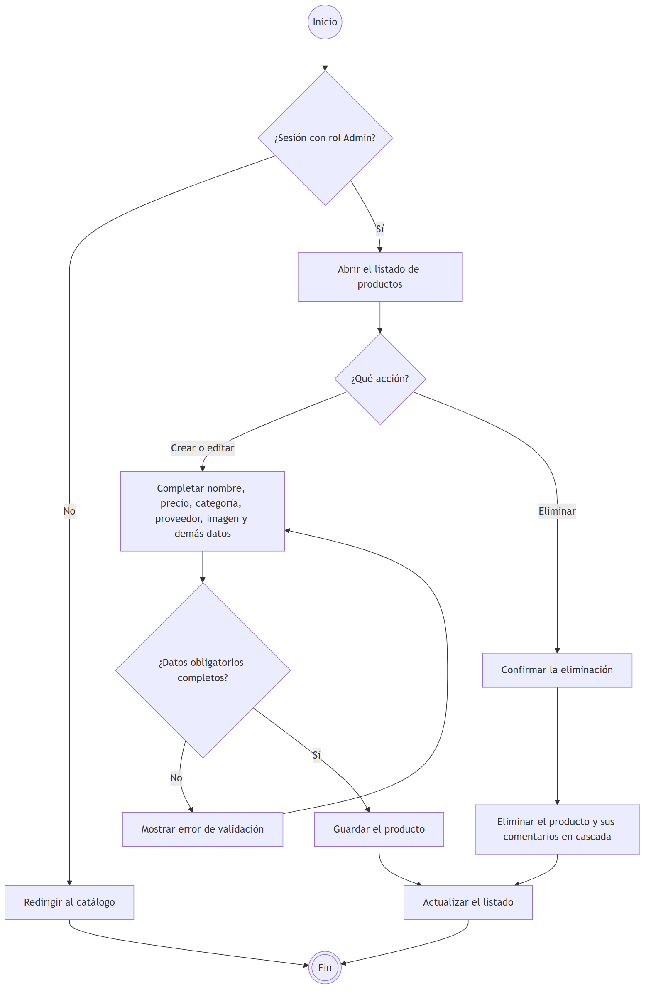

Acceso restringido al rol Admin (RN-06); crear/editar valida datos obligatorios y eliminar borra también los comentarios asociados.

- Fuente editable: [fuentes/act-hu11-productos.mmd](fuentes/act-hu11-productos.mmd)
- Enlace editable (mermaid.live): _pendiente de pegar_

## Actividades HU-13 Listado de pedidos (y despacho HU-14)

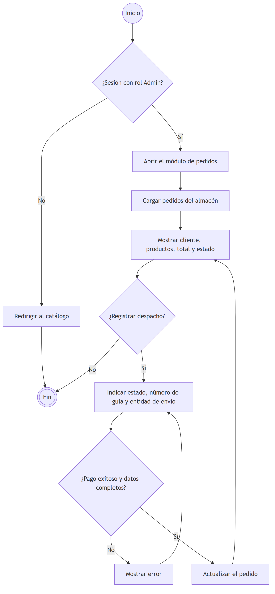

El administrador consulta los pedidos y, si lo desea, registra estado, guía y entidad de envío; solo se despachan pedidos con pago exitoso (RN-05).

- Fuente editable: [fuentes/act-hu13-pedidos.mmd](fuentes/act-hu13-pedidos.mmd)
- Enlace editable (mermaid.live): _pendiente de pegar_

